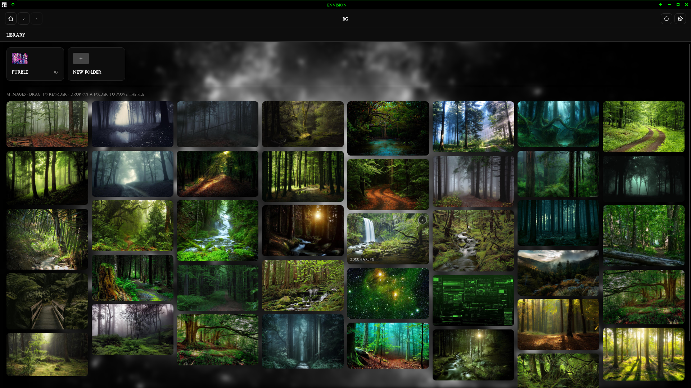

# Envision

A local-first image viewer for desktop. Load folders of images you already have and see them in a responsive masonry grid you can rearrange freely.



## Features

- **Libraries.** Point Envision at a folder of images. Nothing is copied, and Envision writes nothing inside it unless you explicitly move a file yourself.
- **Gallery-dl imports.** Download a board into a chosen destination folder, either with a default path or by prompting every time, then index the imported images as a normal library.
- **Masonry browsing.** A virtualised, responsive grid with per-folder ordering that persists across restarts.
- **Reorder by dragging.** Moving an image to a new position in the grid updates the index and touches no files. The order is yours, and it stays yours.
- **Folder management.** Drag an image onto a folder card to move the file, with collision-safe renaming. Create and rename real directories too.
- **Duplicate detection.** SHA-256 over complete file contents. Identical files are grouped and badged and left exactly where they are.
- **Filesystem monitoring.** Changes made outside Envision are detected and can be rescanned.
- **Broad format support.** Common formats are decoded for thumbnails and viewing. HEIC, AVIF, JPEG XL, SVG, and camera raw are indexed and shown as placeholders; they open with your desktop's associated app.
- **System, light, grey, OLED black, and custom** theme options, plus import defaults and thumbnail CPU tuning in the settings UI.

## What it deliberately does not do

- Copy your images anywhere.
- Automatically reorganise or "tidy" your folders. Folder and image changes happen only when you explicitly make them in Envision.
- Delete a duplicate for you.

If a duplicate is worth removing, that is your call, in your file manager. What Envision gives you is knowing which files are identical and where they are.

## Tech Stack

- **Desktop Runtime:** Tauri 2
- **Frontend:** React + TypeScript + Tailwind CSS
- **State:** Zustand
- **Drag & Drop:** dnd-kit
- **Backend:** Rust
- **Database:** SQLite (per-machine, in app data)
- **Image Processing:** Rust `image` crate
- **Hashing:** `sha2`

## Getting Started

### Prerequisites

- Node.js 18 or higher
- Rust and Cargo
- A C compiler (for building Tauri)

### Development

```bash
npm install
npm run tauri dev
```

### Building for Production

```bash
npm run tauri build
```

### Tests

```bash
cargo test --manifest-path src-tauri/Cargo.toml   # backend
npm test                                         # frontend unit tests
npm run typecheck
```

## Project Structure

```
src/
  api/            typed invoke wrappers, event subscriptions, image URLs
  features/
    launcher/     library list, add, relink, forget
    library/      masonry grid, folder cards, duplicates view
      masonry/    pure layout packer (+ tests)
    viewer/       fullscreen lightbox
  components/     ancestry, icons, scan indicator
  state/          library and settings stores
  types.ts        mirrors of the Rust domain types

src-tauri/
  migrations/     schema for the app database and library indexes
  src/
    commands/     Tauri command and event boundary
    domain/       shared types
    library/      registry, scan, fingerprint, queries, moves, watcher
    database/     connection setup and migrations
    paths/        path validation
    thumbnails/   thumbnail store (SQLite table + in-memory LRU)
    images/       media classification
    platform/     OS app-data locations and index paths
```

## How it is put together

Envision doesn't do anything inside your image folder unless you specifically make a new sub-folder or move an image into a different folder. Its registry, index, ordering, thumbnails, and fingerprint data live in the OS application-data directory:

```
<app-data>/
  settings.db                    library registry and preferences
  libraries/<id>/
    index.db                     folders, assets, SHA-256, display order, thumbnails
```

Your images are read where they lie. Thumbnails are generated on demand from the source file and stored as rows — content key, encoded bytes, dimensions — inside the library's SQLite index, with an in-process LRU over the top. The frontend fetches thumbnails as raw bytes over IPC by asset id and wraps them in a Blob URL, exactly like full-resolution images; the webview never receives a filesystem path or a URL.

## Notes
Been working on this for a while. First time working with Rust, I chose it for the build size.
Importing a library for the first time might take a couple of minutes as it generates thumbnails, depending on how good your CPU is. You can limit the CPU usage in the import settings.
Technically inspired by Cascade, in that I wanted a broader, more flexible masonry image manager rather than just a viewer.

## To do
- Add gallery-dl integration
- Upstream image moving